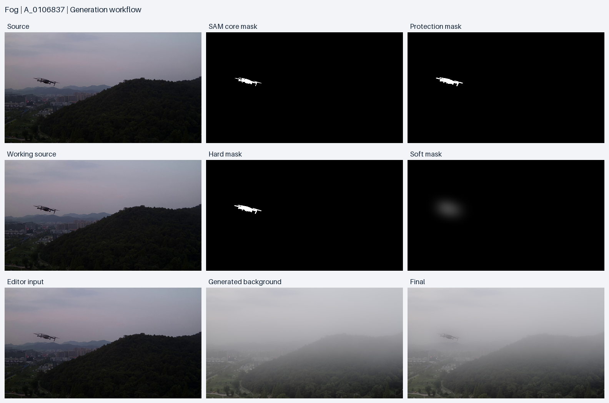
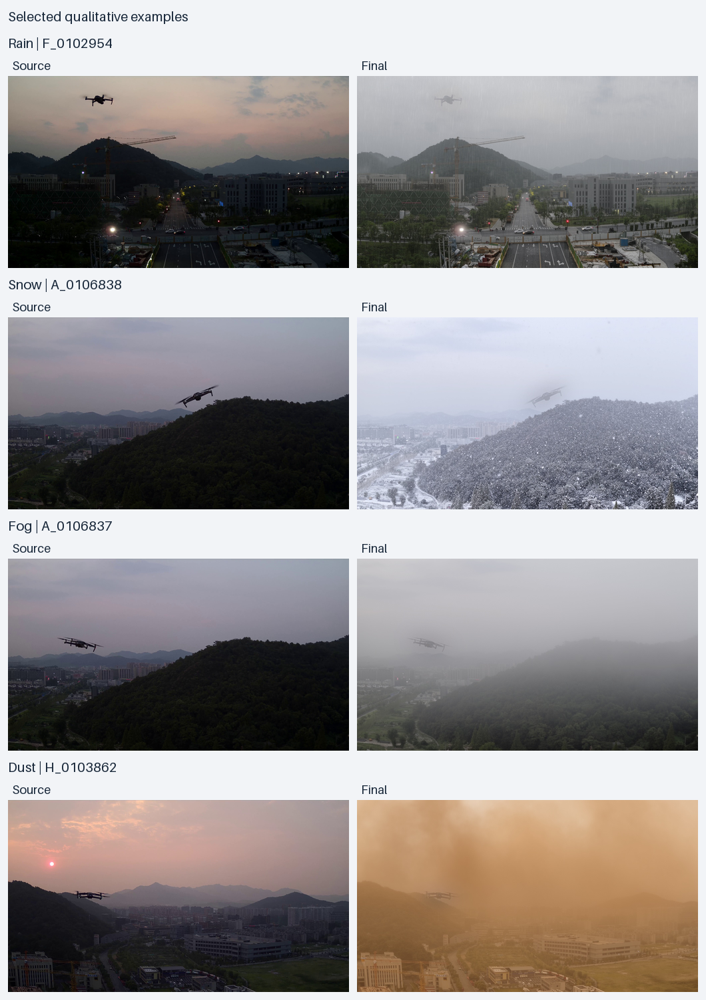

# Generation examples

Source → Mask preparation → Background editing → UAV integration → Final.

## Complete fog example

Source ID: `A_0106837`; condition: `fog`. [flow_manifest.json](flow_manifest.json) records all files, dimensions, SHA-256 values, configuration and prompt references for this single source–condition chain.

| Stage | File |
| --- | --- |
| Source (3840 × 2160) | [image](input/source.jpg), [annotation](input/source.xml) |
| SAM core mask | [core.png](input/core.png) |
| Protection mask | [protection.png](input/protection.png) |
| Working source (1024 × 576) | [working_source.jpg](reference/working_source.jpg) |
| Working hard mask | [hard.png](reference/hard.png) |
| Working soft mask | [soft.png](reference/soft.png) |
| Editor input | [editor_input.jpg](reference/editor_input.jpg) |
| Generated background | [background.jpg](reference/background.jpg) |
| Final | [final.jpg](reference/final.jpg), [annotation](reference/final.xml) |

Core is the cleaned target mask, not an unprocessed SAM candidate. Protection is the core dilated by a 9 × 9 elliptical kernel. Hard and soft masks use the working grid. The soft mask has no peak normalization; it can appear faint in the montage. The unprocessed SAM candidate is not included in this example.

Fusion uses the source RGB, generated background and soft mask in memory. Saved working-source, editor-input and background JPEGs are diagnostic copies; JPEG encoding is lossy. Reloading the background JPEG for a comparison cannot establish byte identity with final. Source annotations retain their coordinates with normalized file metadata; final annotations use the final grid.

## Selected qualitative examples

[gallery/manifest.json](gallery/manifest.json) pairs each source and final with their annotations, configuration, prompt and checksums. The fog entry references the files above without duplicating them. Other entries contain source and final files in their condition directory. These selected qualitative examples do not summarize dataset-wide performance.

| Condition | Source ID | Visual characteristics |
| --- | --- | --- |
| Rain | F_0102954 | Visible rain and haze; road, crane and mountains remain recognizable. |
| Snow | A_0106838 | Snowfall over textured forest; UAV orientation remains recognizable. |
| Fog | A_0106837 | Layered distant haze with visible foreground texture. |
| Dust | H_0103862 | Amber dust with readable terrain and buildings. |

Montages resize images for display without changing contrast or color. Independent image files retain their dimensions. Run `python tools/render_examples.py` from the generation module directory to render both montages.
